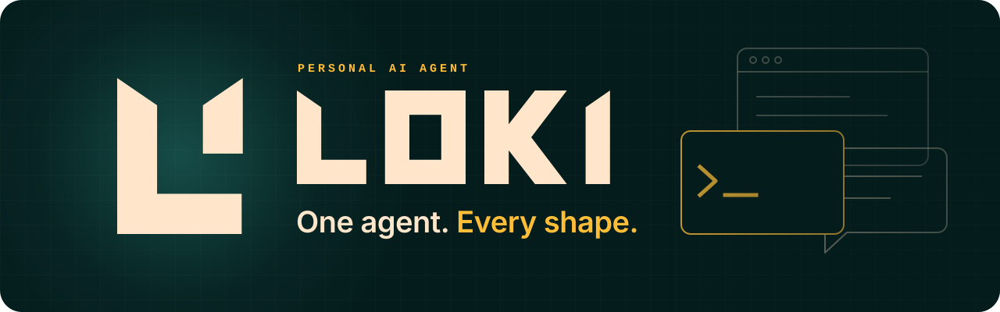

<p align="center">
  
</p>

<p align="center">
  <b>A personal AI agent that remembers you, learns new tricks, and works wherever you do.</b>
</p>

<p align="center">
  <a href="#status"></a>
  <a href="LICENSE"></a>
  
  <a href="https://github.com/NousResearch/hermes-agent"></a>
</p>

<p align="center">
  <a href="#meet-loki">Meet Loki</a> ·
  <a href="#what-loki-does">What Loki does</a> ·
  <a href="#get-started">Get started</a> ·
  <a href="#status">Status</a> ·
  <a href="#built-on-hermes-agent">Built on Hermes</a>
</p>

---

## Meet Loki

Loki is a personal agent for your terminal, projects and recurring work. Its source includes a terminal UI, desktop app, web dashboard and messaging gateway. This release ships source and installers; packaged desktop downloads are not available. Choose an API or local model and configure the integrations you need.

It doesn't start from zero each time. Loki keeps a memory of you and your projects, turns finished work into reusable skills, hands side tasks to subagents, and runs scheduled jobs while you're away.

## What Loki does

These capabilities are retained from the pinned engine. Source availability does not establish full functional parity; external integrations need their own configuration and acceptance.

<table>
<tr>
<td width="50%" valign="top">

**Remembers you**<br>
Persistent memory and searchable session history, so context carries from one conversation to the next.

</td>
<td width="50%" valign="top">

**Learns new tricks**<br>
Turns solved problems into skills it can reuse, and sharpens them each time it runs them.

</td>
</tr>
<tr>
<td width="50%" valign="top">

**Lives where you work**<br>
A terminal UI, desktop app, web dashboard, and a messaging gateway for Telegram, Discord, Slack and more.

</td>
<td width="50%" valign="top">

**Any model, no lock-in**<br>
Bring an API key or run a local model. Change providers without changing code.

</td>
</tr>
<tr>
<td width="50%" valign="top">

**Delegates and schedules**<br>
Splits big jobs across parallel subagents and runs recurring tasks on its own schedule.

</td>
<td width="50%" valign="top">

**Runs anywhere, extends at the edges**<br>
Local, Docker, SSH or cloud sandboxes. Add plugins, skills and MCP servers.

</td>
</tr>
</table>

## Get started

[Loki 0.1.0-alpha.1](https://github.com/ObliviousOdin/loki/releases/tag/v0.1.0-alpha.1) is an **unsigned source preview**, built from commit `12690b426de4610916f91fb42f008391df550f27`. The public repository needs no GitHub account or token to clone.

On macOS or Linux, install the exact preview:

```bash
git clone --branch v0.1.0-alpha.1 https://github.com/ObliviousOdin/loki.git
cd loki
test "$(git rev-parse HEAD)" = "12690b426de4610916f91fb42f008391df550f27" &&
  /bin/bash scripts/install.sh --branch main --commit 12690b426de4610916f91fb42f008391df550f27 --channel main --non-interactive --skip-browser --skip-computer-use
```

On Windows, use PowerShell:

```powershell
git clone --branch v0.1.0-alpha.1 https://github.com/ObliviousOdin/loki.git
Set-Location loki
if ((git rev-parse HEAD) -ne '12690b426de4610916f91fb42f008391df550f27') { throw 'Unexpected Loki preview commit' }
.\scripts\install.ps1 -Branch main -Commit 12690b426de4610916f91fb42f008391df550f27 -Channel main -NonInteractive -SkipBrowser -SkipComputerUse
```

These explicit lean options omit browser and computer-use dependencies. See the [installation guide](docs/loki/INSTALL.md) for the full source installation, artifact checksums and configuration. Python reports the equivalent version `0.1.0a1`.

Open a new terminal and say hello:

```bash
loki --version
loki --help
loki setup    # choose a provider and model first
loki          # start talking
```

**Your data stays separate.** Loki keeps its config, sessions, memory, skills, logs, caches and managed tools in `~/.loki` on macOS and Linux, or `%LOCALAPPDATA%\loki` on Windows. `LOKI_HOME` and `LOKI_RUNTIME_DIR` provide explicit overrides. The retained engine checkout leaf, `hermes-agent`, stays inside Loki's directory. Existing agent state and external Codex/Claude logins are not adopted automatically.

## Status

Loki is an **alpha**. The [published verification report](https://github.com/ObliviousOdin/loki/releases/download/v0.1.0-alpha.1/LOKI-VERIFICATION.json) records the exact source, results, skips and limits.

- **Measured checks:** all 16 merged-commit CI jobs passed, including Linux Python, UI/Electron checks, builds and controlled lean source-install scenarios on Linux, macOS and Windows. Two intermittent test failures remain unresolved despite successful retries. An additional default-path macOS public-network installation and CLI/TUI startup check remains unqualified.
- **Credentials and integrations:** a real provider conversation/resume, live messaging, OAuth and hosted services still need dedicated credentials and acceptance. Upstream subscriptions, trials and applications do not transfer. Select a model with `loki setup` before starting the TUI; a blank model can report `storage_unavailable`.
- **Distribution:** packaged native applications, signing/notarization and native installation/update flows remain unqualified. Packaged automatic updates are disabled. Source updates use this project's repository and default to `main`; review changes and keep the preview pinned until you choose to update.

See [parity and verification](docs/loki/VERIFICATION.md), [release notes](docs/loki/RELEASE-NOTES.md) and [delivery status](docs/loki/PREVIEW-STATUS.md) for the requirements before a stable release.

## Built on Hermes Agent

Loki is an independent fork of [Hermes Agent](https://github.com/NousResearch/hermes-agent) by [Nous Research](https://nousresearch.com). It is not published or endorsed by Nous Research. Internal names such as `hermes_cli` keep their upstream spelling so the engine stays easy to update. The [recorded baseline](docs/loki/UPSTREAM.json) is `18c525b669b6ea4ba62e6967d228af21d89aa9d3`, dated October 17, 2026, 1,376 commits after `v0.22.2`.

The original Hermes README, with its install guide, command reference, documentation links and translations, now lives in **[docs/hermes](docs/hermes/README.md)**.

## Contributing

Read the [development guide](AGENTS.md) first, then [CONTRIBUTING.md](CONTRIBUTING.md) for the test environment. Choose an isolated `LOKI_HOME` before activating development tools. [Maintenance](docs/loki/MAINTENANCE.md) covers history-preserving upstream updates and protected CI; [follow-ups](docs/loki/FOLLOWUPS.md) lists the prioritized improvements.

```bash
source ./activate        # provision and enter the development environment
python scripts/check     # every blocking lint check CI runs
scripts/run_tests.sh     # the test suite (never bare pytest)
```

## License

MIT. See [LICENSE](LICENSE). Hermes Agent is © 2025 Nous Research. Required upstream attribution and third-party notices are retained in [NOTICE](NOTICE) and the relevant source directories; bundled dependencies retain their own licenses.

<br>

<p align="center">
  <picture>
    <source media="(prefers-color-scheme: dark)" srcset="assets/loki-mark-white.svg">
    
  </picture>
  <br>
  <sub>One agent. Every shape.</sub>
</p>
